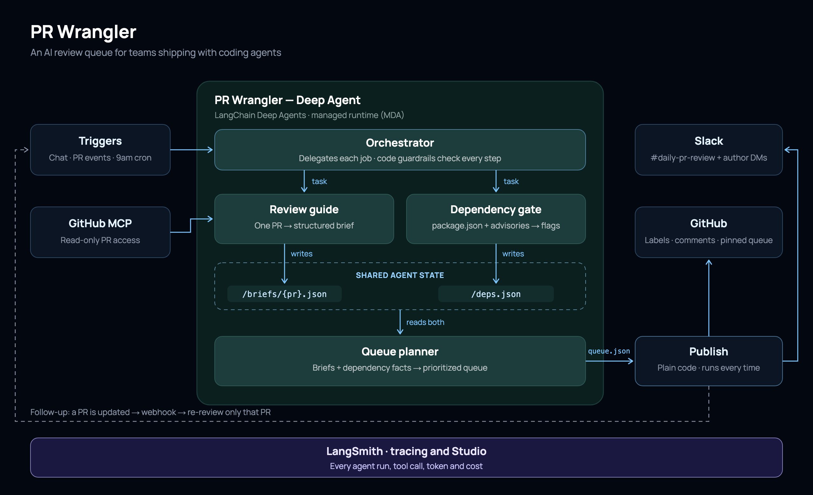

# PR Wrangler

**An AI review queue for teams shipping with coding agents.**

AI coding tools made writing code cheap; reviewing it didn't get any cheaper. When seven developers each ship with a coding agent, the tech lead opens GitHub to 15 PRs and no idea where to start. PR Wrangler reads every open PR and turns the pile into an ordered review queue: what each PR really does, the line to start reading, risky dependencies, PRs that collide, and what to merge first. Results go back to GitHub and Slack. It never approves or merges.



## How it works

A LangChain **Deep Agent** (LangSmith Managed Deep Agents) with one orchestrator and three subagents:

| Agent | Job | Output |
|---|---|---|
| Orchestrator | Lists open PRs through GitHub MCP, delegates, publishes | — |
| Review guide | Reads one PR in depth | `ReviewBrief`: summary, risk, the line to start at, real problems |
| Dependency gate | Checks every package change across all PRs | `DependencyReport`: duplicates, vulnerabilities, version drift, heavy packages |
| Queue planner | Ranks everything into lanes | `ReviewQueue`: quick win, review, fix first, blocked, with reasons, collisions, review-together pairs |

Code handles anything with a right answer: dependency diffs and advisories, line-level collisions between PRs, lanes, and every write to GitHub and Slack. The models handle judgment and wording. Guardrails in middleware stop the orchestrator from bundling PRs or planning before every PR is reviewed.

## Demo

- **Demo repo:** [dhanush014/tiny-todo](https://github.com/dhanush014/tiny-todo), a small to-do app with 15 seeded PRs, each hiding a planted problem. PR Wrangler's labels, briefs, "Start here" comments and the pinned Review Queue issue are live there.
- **Evals:** 24 checks built from the planted answers (`seed/expected.json`), graded by code and tracked as a LangSmith experiment: **24/24 pass**.

## Repo layout

```text
agent/        the Managed Deep Agent project (agent.py, instructions, subagents, tools, middleware, channels, schedules, scripts)
seed/         builds the 15 demo PRs; planted answers; reset script
diagrams/     workflow diagram (SVG + PNG)
slides/       demo slides
PR_WRANGLER_WRITEUP.md / .pdf  problem, solution, tools and skills
PR_WRANGLER_VIDEO.md / .pdf    demo video script
md2pdf.py     renders the Markdown docs to PDF
```

## Run it

```bash
cd agent
uv sync
uv run mda dev --no-reload --port 2024     # local agent server + LangSmith Studio
uv run python scripts/ask.py "Wrangle the queue."
```

`agent/.env` needs `LANGSMITH_API_KEY`, `GROQ_API_KEY`, `GITHUB_TOKEN`, `GITHUB_WEBHOOK_SECRET`, and optionally the Slack settings described in [agent/README.md](agent/README.md).

## Stack

LangSmith Managed Deep Agents · Deep Agents · LangGraph · LangChain middleware · Groq (gpt-oss-120b, qwen3.8-27b) · GitHub MCP · GitHub REST/GraphQL · Slack Web API · Slack MCP · Pydantic · LangSmith tracing, Studio, datasets and experiments · Python · uv
